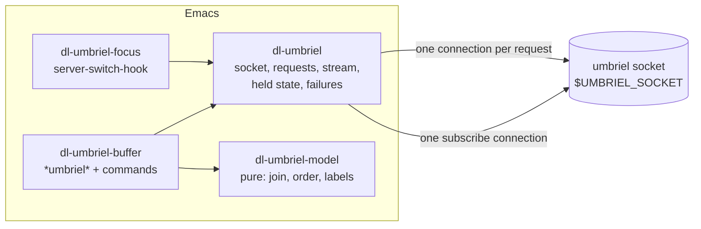
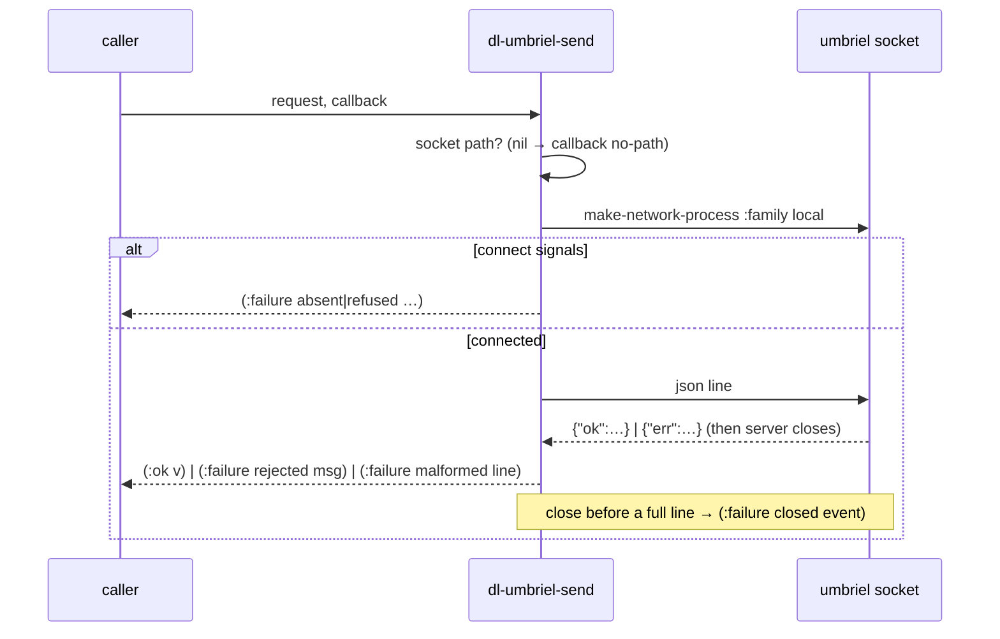
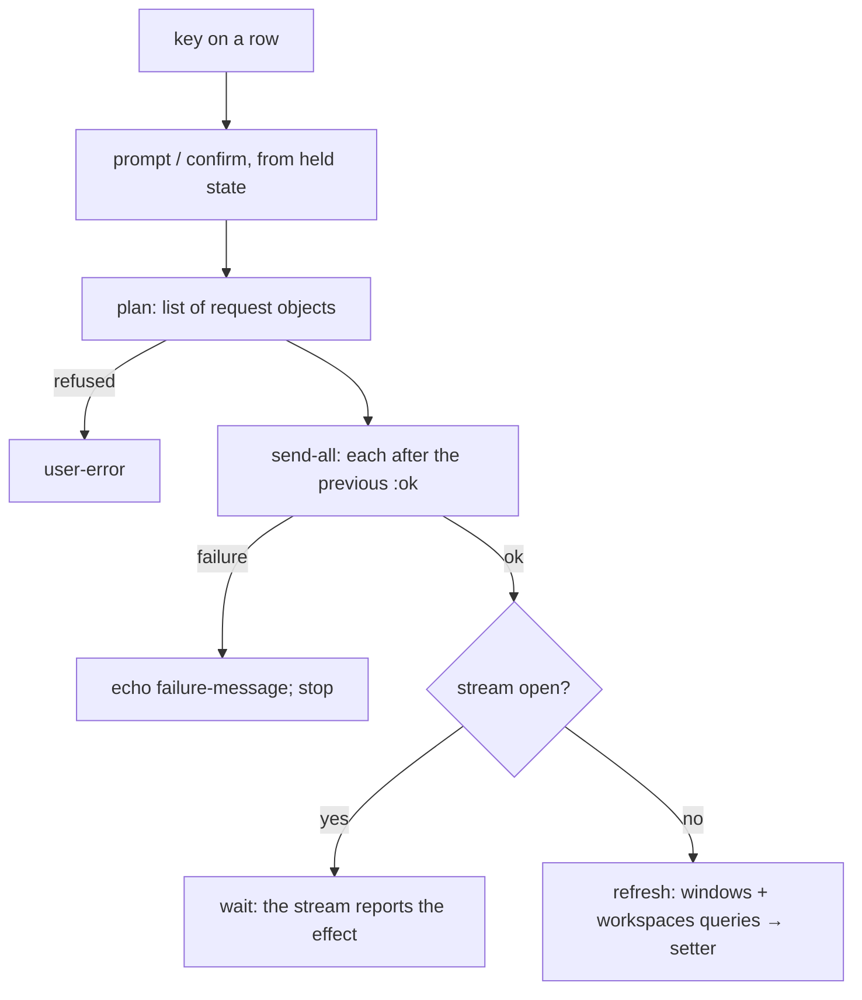
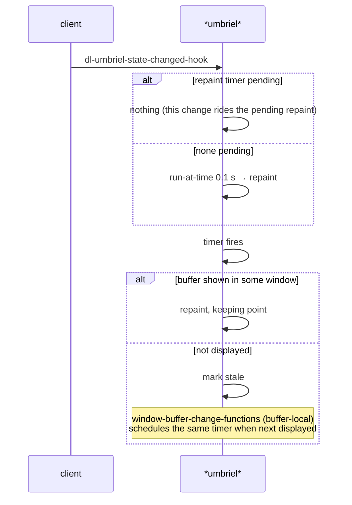
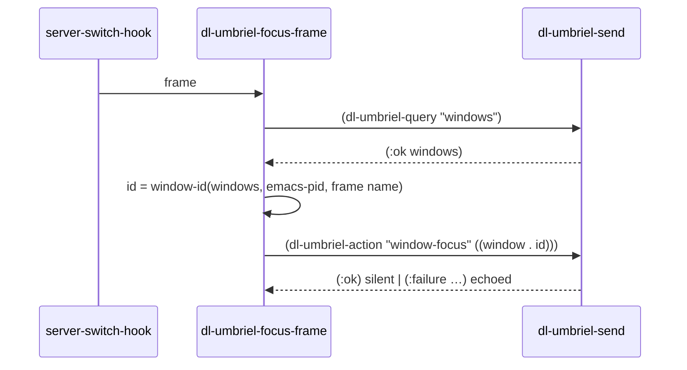

<!-- doctrine:section sec-overview -->
## Overview

Today Emacs touches umbriel, the Wayland compositor, in one place: when
`emacsclient` reuses a frame, `lisp/dl-umbriel.el` runs `umbriel windows
--json`, finds the frame's window by `(pid, title)` and runs `umbriel msg
window-focus <id>`. Wayland only raises a window for a client that holds an
activation token, and `emacsclient` brings none, so without this the frame
stays behind the terminal.

This design replaces that with a small control surface:

- **a socket client** that talks umbriel's JSON IPC protocol directly over its
  UNIX socket, with no `umbriel` process executed;
- **a live view** of windows and workspaces, fed by the compositor's
  full-snapshot event stream;
- **a buffer** (`*umbriel*`, a `magit-section` tree) that lists workspaces
  with their windows nested under them, and acts on the row at point;
- **a few global keys** under `C-c u` for workspace verbs that do not need the
  buffer.

**Where the boundary sits.** The compositor owns all layout state. Emacs holds
only the latest snapshots the compositor sent, replaces them wholesale on each
event, and never predicts the effect of an action: it sends a request and then
shows whatever the compositor reports next. Emacs cannot name its own windows
more precisely than "this process's window with this title"; frame identity is
a follow-up (IDE-003) and nothing here depends on it.



The diagram shows ownership and dependency direction: only the client touches
the socket; the model depends on nothing in Emacs beyond `seq`/`subr-x`; the
buffer and the focus feature are the two consumers. The client never knows the
buffer exists — it announces change through a hook (see *Held state and the
stream*).

Governing decisions: DEC-012 to DEC-024, all shaping SL-016. Each section below
names the ones it implements.

<!-- doctrine:section sec-files -->
## Files and their concerns

Four files in `apps/`, beside the other integrations with external programs
(DEC-014, applying STD-001 "one concern per file"). Each file's name states its
one concern.

| file | concern | requires | provides to others |
|---|---|---|---|
| `apps/dl-umbriel.el` | talking to the compositor: socket path, request objects, transport, the stream connection, held state, failure kinds | `seq`, `subr-x` | request builders, `dl-umbriel-send`, `dl-umbriel-send-all`, stream open/close, state readers, the change hook, the waiter, `dl-umbriel-failure-message` |
| `apps/dl-umbriel-model.el` | pure functions over parsed snapshots: the workspace join, ordering, selectors, display strings | `seq`, `subr-x` | `dl-umbriel-model-*` |
| `apps/dl-umbriel-buffer.el` | the `*umbriel*` buffer, its repaint, the row commands and the action table, the global workspace commands | `magit-section`, `dl-umbriel`, `dl-umbriel-model` | `my/umbriel` and the `my/umbriel-*` commands, `dl-umbriel-buffer-mode-map` |
| `apps/dl-umbriel-focus.el` | focusing the frame `emacsclient` reuses | `dl-umbriel` | `dl-umbriel-window-id`, `dl-umbriel-focus-frame` |

`init.el:23` changes from `(require 'dl-umbriel)` to requiring
`dl-umbriel-focus` and `dl-umbriel-buffer`; each pulls in the client. The model
does not require the client: it takes parsed data as arguments, so its tests
load no process code.

`lisp/dl-umbriel.el` is `git mv`ed to `apps/dl-umbriel.el` and rebuilt (its
header now describes the client, not focus). The focus code moves out to its
own file. Every new file is `git add`ed before any `home-manager switch` — flake
builds see only tracked files (AGENTS.md trap 1).

Naming follows `docs/emacs/naming.md`: `dl-umbriel-…` public internals,
`dl-umbriel--…` private, `my/umbriel…` for user-callable commands. The
commands live in `dl-umbriel-buffer.el` because the buffer file owns the
user-facing surface ("role beats file").


<!-- doctrine:section sec-client -->
## The socket client: requests, transport, failures

Implements DEC-012 (socket path), DEC-015 (result shape), DEC-017 (builders,
async-only transport), DEC-013's parse options.

### Socket path

`dl-umbriel-socket-path` is a function of the environment, called at every
connect and never cached. It mirrors the CLI (`src/cli/ipc_client.cpp:22-32`)
exactly; an empty variable counts as unset.

```elisp
(defun dl-umbriel-socket-path ()
  "Umbriel's socket path from the environment, or nil."
  (let ((explicit (getenv "UMBRIEL_SOCKET"))
        (runtime (getenv "XDG_RUNTIME_DIR"))
        (display (getenv "WAYLAND_DISPLAY")))
    (cond ((dl-umbriel--present-p explicit) explicit)
          ((and (dl-umbriel--present-p runtime) (dl-umbriel--present-p display))
           (format "%s/umbriel-%s.sock" runtime display)))))
```

When it returns nil the failure is `no-path`, and its detail names the unset
variables. There is no defcustom: `UMBRIEL_SOCKET` (via `setenv`) is the
override.

### Request objects

Requests are plain alists built by pure functions; `json-serialize` encodes
them. Optional fields with a nil value are dropped, because the compositor
rejects empty or unexpected fields (`docs/user/ipc.md` § Actions).

```elisp
(dl-umbriel-query "windows")                 ; => ((cmd . "windows"))
(dl-umbriel-action "window-focus" `((window . ,id)))
;; => ((cmd . "action") (action . "window-focus") (window . "…"))
(dl-umbriel-action "workspace-switch" '((workspace . 2) (output . "DP-1")))
(dl-umbriel-action "workspace-set-layout" '((layout . "master")))
dl-umbriel-subscribe-request
;; => ((cmd . "subscribe") (events . ["windows" "workspaces"]))
```

`events` is a vector: `json-serialize` reads a list as an object, so JSON
arrays must be vectors.

Field names used by v1, from `ipc.md`'s field table: `window` (window id
string), `workspace` (number = position, string = name — a named workspace
called `"2"` is still sent as the string), `output` (string), `layout`
(`scrolling|dwindle|master|stacking|toggle`).

### Parsing

One function, `dl-umbriel-parse`, parses every line the compositor sends:

```elisp
(json-parse-string line :object-type 'alist :array-type 'list
                        :false-object nil :null-object nil)
```

`:false-object nil` matters: the default `:false` keyword is truthy, so every
boolean predicate would lie.

### Result shape and failure kinds

Every request, and the stream, reports one shape: `(:ok VALUE)` or
`(:failure KIND DETAIL)`.

| KIND | cause | DETAIL | remedy the message points to |
|---|---|---|---|
| `no-path` | socket path unresolvable | the unset variable names | `setenv UMBRIEL_SOCKET` |
| `absent` | connect signals `file-missing` | the socket path | start umbriel / wrong session |
| `refused` | connect signals any other `file-error` (`Connection refused` on a stale socket) | the error message | restart umbriel |
| `closed` | the connection ended before a reply, or the stream ended | the sentinel event string | reconnect (`g`) |
| `rejected` | the reply was `{"err": …}` | the compositor's message | read it |
| `malformed` | a reply line that is not a JSON object | the line, truncated | report upstream |

`dl-umbriel-failure-message` renders a failure as one sentence that begins with
the kind, e.g. `umbriel: absent — no socket at /run/user/1000/umbriel-wayland-1.sock`.
The connect-error mapping (`file-missing` → absent, other `file-error` →
refused) is observed in `emacs --batch -Q` (SL-016 research addendum), not
assumed.

### Transport

`dl-umbriel-send REQUEST CALLBACK` opens a fresh local connection, writes the
request plus newline immediately (the server allows 1 s to send it), and calls
CALLBACK exactly once:



The pieces that decide anything are pure, so the glue stays thin:

- `dl-umbriel--take-lines PENDING CHUNK` → `(LINES . REST)`: appends CHUNK to
  the unfinished PENDING text and splits off every complete line.
- `dl-umbriel--reply-result LINE` → the DEC-015 result for one reply line.
- `dl-umbriel--connect-failure ERR` → the failure for a connect signal.

Every connection (request and stream) is opened with `:coding 'utf-8-unix`
and `:noquery t`. The coding system makes the filter receive decoded text —
window titles are not ASCII — and lets the decoder carry a UTF-8 sequence split
across two chunks; `json-serialize` returns unibyte UTF-8, which the encoder
passes through unchanged (both verified in Emacs 31.1 over a local socket).
`:noquery` keeps a live stream from making Emacs ask on exit.

The filter and sentinel are passed as `:filter` / `:sentinel` arguments to
`make-network-process` and keep their partial line in a closure variable, not
in process properties, so tests can capture and drive them without a real
process. A `delivered` flag in the same closure enforces "exactly once": the
first complete line sets the flag, then calls back, then deletes the process;
the sentinel delivers `closed` only if nothing was delivered. The order
matters: `delete-process` runs the sentinel synchronously (observed in Emacs
31.1), so a flag set after deletion would deliver twice. A write that signals
(`process-send-string` on a connection the server already closed) is caught
and delivered as `(:failure closed DETAIL)`. The server ends every reply with a
newline (`ipc.cpp:359`), so text left without one at close is not a reply.

A server that accepts and never answers (a stopped compositor) leaves the
callback pending until the connection closes. There is no timeout (DEC-017);
each action is its own request, so one stuck request blocks nothing else.

There is no synchronous path and therefore no timeout kind (DEC-017). Every
caller is callback-driven; nothing blocks a hook or the command loop.

`dl-umbriel-send-all REQUESTS CALLBACK` sends a list of requests in order, each
after the previous reply was `(:ok …)`, and calls CALLBACK once with the first
failure or the last success. This is the sequencing that focus-then-act
(DEC-016) needs.

<!-- doctrine:section sec-state -->
## Held state and the stream

Implements DEC-018 (stream lifetime), DEC-020 (held state, hook, waiter),
DEC-015 for the stream's failures.

### Held state

`dl-umbriel.el` owns one private state record. Nothing else writes it.

| part | value | written by |
|---|---|---|
| windows | the latest `windows` snapshot, as parsed (list of alists, unknown fields kept) | stream event or refresh reply |
| workspaces | the latest `workspaces` snapshot, as parsed | stream event or refresh reply |
| stream status | `never`, `open`, or `(:failure KIND DETAIL)` | stream open / sentinel / first-line `err` |
| skipped | count of stream lines skipped on the current connection (malformed, or a family we did not ask for); reset to 0 by `stream-open` | stream filter |

A window's opaque `id` is its key: readers look a window up with
`dl-umbriel-window ID`. The snapshot lists are held as parsed rather than
re-indexed; there are tens of windows, and a second structure would be a
second thing to keep in step.

One setter, `dl-umbriel--set-family FAMILY DATA`, replaces a family wholesale
— events are full snapshots, so nothing is merged. Stream events and refresh
replies both go through it, so there is one write path.

Readers: `dl-umbriel-windows`, `dl-umbriel-workspaces`,
`dl-umbriel-stream-status`, `dl-umbriel-skipped`, `dl-umbriel-window`, and
`dl-umbriel-state` (a plist of all four, the argument waiters receive).

### Announcing change

Two ways to observe the state; the client knows no consumer:

- `dl-umbriel-state-changed-hook` — no arguments; run after every write
  (setter, status change, skipped-count change). The buffer listens here.
- `dl-umbriel-await PREDICATE CALLBACK` — a one-shot waiter. The client calls
  `(funcall PREDICATE STATE)` once at registration and again after each
  change; when it holds, CALLBACK gets `(:ok STATE)` and the waiter is dropped.
  When the stream closes, every pending waiter gets the closing `(:failure …)`.
  Registering while the stream is not open calls back at once with the current
  failure, or `(:failure closed "stream not open")` when it was never opened.
  No waiter outlives the stream. Waiters run after the hook, each under
  `with-demoted-errors`; a predicate or callback that signals drops its own
  waiter and cannot stop the hook or other waiters. v1 has
  no consumer of the waiter beyond tests; it exists because the frame-identity
  handshake (IDE-003) needs to await "the snapshot in which my new frame
  appears" without polling.

### The stream connection

At most one subscribe connection exists. `dl-umbriel-stream-open` opens it if it
is not already open; `dl-umbriel-stream-close` closes it. The buffer opens it
when the buffer is created and closes it from a buffer-local
`kill-buffer-hook`. Nothing reconnects automatically: `g` in the buffer is the
only reconnect. The compositor answers every new subscription with the current
state of each requested family before any change event (`ipc.cpp:625`; there
is no `{"ok"}` acknowledgement), so a reconnect needs no separate refresh.

```mermaid
stateDiagram-v2
  [*] --> never
  never --> open: stream-open succeeds
  never --> failed: stream-open fails (no-path / absent / refused)
  open --> failed: sentinel (closed, incl. eviction past 256 KiB)\nor first line is {"err"} (rejected)
  open --> never: stream-close (buffer killed)
  failed --> open: g (stream-open)
  failed --> never: stream-close
  note right of failed: status = (:failure KIND DETAIL)\npending waiters fail
```

`failed` in the diagram is the status `(:failure KIND DETAIL)`. Closing on
request returns to `never` rather than `failed`, because nothing went wrong.
The held snapshots are kept on close: the buffer shows them under a header that
says the stream is closed and why, so a stale buffer always says it is stale.

### Stream lines

Each complete line goes through `dl-umbriel--stream-line LINE`:

```text
{"event":"windows","data":[…]}     → set windows
{"event":"workspaces","data":[…]}  → set workspaces
{"event":"theme",…}                → skipped += 1   (family not requested)
not a JSON object                  → skipped += 1
{"err":"…"}                        → status (:failure rejected msg); close
```

A malformed or unexpected line is counted and skipped, never fatal; the count
shows in the buffer header when non-zero, which is how an upstream format
change becomes visible instead of silent.

<!-- doctrine:section sec-model -->
## The model

Implements DEC-013. `dl-umbriel-model.el` is pure: parsed data in, data or
strings out. No compositor calls, no buffer mutation.

### Data shapes

Entries are the parsed alists (DEC-013 parse options), trimmed here to the
fields the model reads:

```elisp
;; workspace entry (ipc_commands.cpp:807-833)
((id . "DP-1:7") (name . "web") (named . t) (index . 2) (output . "DP-1")
 (active . t) (focused . t) (occupied . t) (window_count . 3)
 (focused_window . "w-abc") (urgent) (layout . "scrolling") (layout_override))

;; window entry (ipc_commands.cpp:626-722)
((id . "w-abc") (workspace . "DP-1:7") (scratchpad . "") (app_id . "foot")
 (title . "~/src — zsh") (floating) (column . 0) (row . 1) (tabbed)
 (tab_index . -1) (active . t) (focused . t) (visible . t) (minimized)
 (fullscreen) (urgent) (xwayland) (pid . 4242))
```

Every read is `alist-get` with a default (`""` for strings, `-1` for
positions and `pid`, nil for booleans), so a renamed upstream field degrades a
label instead of signalling.

### Functions

| function | returns |
|---|---|
| `dl-umbriel-model-group WORKSPACES WINDOWS` | ordered list of `(WORKSPACE . WINDOWS)`; a final `(nil . WINDOWS)` group holds every window that joins no held workspace — `workspace` `""` (scratchpad, unassigned), nil, or an id the workspaces snapshot does not contain (the two families arrive as separate lines) — omitted when empty. No window is ever dropped |
| `dl-umbriel-model-workspace-selector WORKSPACE` | the action fields addressing it: `((workspace . NAME-OR-INDEX) (output . OUTPUT))` |
| `dl-umbriel-model-window-workspace WORKSPACES WINDOW` | the workspace entry a window belongs to, or nil |
| `dl-umbriel-model-workspace-choices WORKSPACES` | `(LABEL . WORKSPACE)` pairs for `completing-read`, in display order |
| `dl-umbriel-model-workspace-label WORKSPACE` | one-line display string |
| `dl-umbriel-model-window-label WINDOW` | one-line display string |
| `dl-umbriel-model-layouts` | constant: `("scrolling" "dwindle" "master" "stacking" "toggle")` |

**The two addressing fields are not interchangeable.** The join uses the
workspace's opaque `id` (synthesised `OUTPUT:serial`; the compositor does not
accept it as a selector). Actions use the selector: the `name` string when
`named` is true — even if the name is all digits — else the `index` number,
always with `output`, because an unqualified name resolves on the pointer's
output (`actions.cpp:82-83`). Windows are the reverse: actions take the opaque
window `id`.

**Ordering.** Workspaces by `output`, then `index`. Windows within a group:
tiled before floating; tiled by `column` then `row` (`-1` — non-scrolling
layouts — after placed ones), then `tab_index` so a tab group keeps its order;
remaining ties and floating windows by `title`.

### Display strings

Illustrative, not normative wording:

```text
DP-1 2 web  scrolling  3 windows  active focused
  foot  ~/src — zsh            tile 0,1  active focused visible
  firefox  Docs                float     visible
  emacs  notes.org - GNU Emacs tab 2     focused
Unassigned
  pavucontrol  Volume          float     minimized
```

- Workspace: output, index, name (when `named`), layout, window count, and
  `active` / `focused` / `urgent` marks. The count is the number of windows the
  join placed under it, not the wire's `window_count`, so the label always
  agrees with the rows beneath it.
- Window: app id, title, placement (`tile C,R`, `float`, or `tab I`), then
  separate `active` and `focused` marks, then `visible`, `minimized`,
  `fullscreen`, `urgent`, `xwayland` flags.
- Every compositor-supplied string (app id, title, name) has newlines and tabs
  replaced by spaces, so a row is always one line.

`active` (seat-global) and `focused` (the workspace's remembered focus) are
always shown separately — a scratchpad or layer surface holding the keyboard
makes them disagree. `visible` is labelled `visible`, never "on screen": it
means "on the active workspace, not a hidden tab, not minimized", and such a
window may be scrolled out of view.

<!-- doctrine:section sec-actions -->
## Actions

Implements DEC-016 (addressing, focus-then-act, the action table), DEC-019
(kill), DEC-021 (one connection per request, failures, re-query).

### Addressing

The row at point is what the user means. Many umbriel actions only act on the
*focused* window, and "focused" diverges from "the row at point" as soon as the
buffer lags, so those run as two requests: focus the row's window, then act.
Workspace actions address the workspace by selector (see *The model*).

| addressing | window row | workspace row |
|---|---|---|
| `window` — action takes a window id | `[ACTION window=ID]` | refused: "not a window" |
| `focused` — action takes only the focused window | `[window-focus window=ID, ACTION]` | `[ACTION]` (acts on what is focused) |
| `workspace` — workspace-switch | `[switch SELECTOR-of-its-workspace]` | `[switch SELECTOR]` |
| `active-workspace` — workspace-set-layout | `[switch SELECTOR-of-its-workspace, ACTION]` | `[switch SELECTOR, ACTION]` |

A window in the Unassigned group has no workspace selector; `workspace` and
`active-workspace` actions refuse on it with a message.

`workspace-set-layout` acts on the active workspace of the output under the
cursor (`focus.cpp:540`, `server_outputs.cpp:117`), and `workspace-switch`
need not move the cursor. So the `active-workspace` plan also refuses when the
target workspace's `output` differs from the output of the held workspace
marked `focused` — which the compositor sets exactly for the active workspace
on the cursor's output (`ipc_commands.cpp:831`). The refusal says "layout acts
on the output under the pointer". `C-c u l` has no row and simply acts there;
its prompt says so.

### One table

v1 actions are declared in one table; each further action costs a row and a
key. An action the table cannot carry cheaply is cut from v1, not
special-cased.

```elisp
(defconst dl-umbriel-buffer-actions
  ;; COMMAND                         ACTION                          ADDRESSING        PROMPT
  '((my/umbriel-focus                "window-focus"                  window)
    (my/umbriel-toggle-floating      "window-toggle-floating"        window)
    (my/umbriel-kill                 "window-kill"                   window           confirm-kill)
    (my/umbriel-center               "window-center"                 focused)
    (my/umbriel-cycle-extent         "window-cycle-primary-extent"   focused)
    (my/umbriel-cycle-extent-back    "window-cycle-primary-extent-back" focused)
    (my/umbriel-column-left          "column-move-left"              focused)
    (my/umbriel-column-right         "column-move-right"             focused)
    (my/umbriel-scroll-left          "layout-scroll-left"            focused)
    (my/umbriel-scroll-right         "layout-scroll-right"           focused)
    (my/umbriel-move-to-workspace    "window-move-to-workspace"      focused          workspace)
    (my/umbriel-switch               "workspace-switch"              workspace)
    (my/umbriel-set-layout           "workspace-set-layout"          active-workspace layout))
  "Row actions: command, umbriel action, how the row is addressed, what is prompted.")
```

A macro expands each row into an interactive command with a generated
docstring. `my/umbriel-focus` on a window row is `[window-focus window=ID]`;
the `focused` rule would only repeat it.

The prompts:

- `workspace` — `completing-read` over `dl-umbriel-model-workspace-choices` of
  the held workspaces; the choice's selector fields join the request
  (`window-move-to-workspace`; the non-silent form, so focus follows the
  window; `-silent` is not in v1).
- `layout` — `completing-read` over `dl-umbriel-model-layouts`; sent as
  `layout`. `toggle` is sent without `cycle` (the compositor's configured
  cycle).
- `confirm-kill` — the target is captured from point before the prompt and
  carried into the plan, so a repaint while `y-or-n-p` is open cannot redirect
  it. DEC-019: `window-kill` kills the **process** owning the
  window (`actions.md:174`). If the window's `pid` equals `(emacs-pid)` the
  command refuses ("use delete-frame"); otherwise `y-or-n-p` names app id,
  title and pid. `pid` `-1` (X11, no `_NET_WM_PID`) is confirmed like any other.

### Planning is pure

`dl-umbriel-buffer--plan SPEC TARGET FIELDS` returns the list of request
objects for one table row, a target (`(:window ENTRY)` or `(:workspace ENTRY)`
from the section at point) and the prompted fields — or a `user-error`
message string when the addressing refuses the target. The command then hands
the list to `dl-umbriel-send-all`. Tests cover every addressing × target cell
without a socket.



### After an action

Sequencing on replies is sound because the compositor runs an action inside
the request handler and replies afterwards (`src/server/ipc.cpp:595`): when
`window-focus` answers `{"ok":null}`, the window is already focused.

`(:ok …)` is silent; a `(:failure …)` is echoed with
`dl-umbriel-failure-message` and stops the sequence. After the last step, if
the stream is not open, `dl-umbriel-refresh` issues async `windows` and
`workspaces` queries whose replies go through the state setter. The effect of
an action is never written locally; the buffer shows only what the compositor
reports. A row action may visibly move focus or switch workspace before it acts
— documented in `docs/emacs/umbriel.md`.

### Prompts never run inside a process callback

All buffer prompts run in the command, before any request, from the held state,
after the target has been captured from point.
The global `C-c u w` (switch workspace) may run with no buffer and therefore no
held workspaces; it then calls `dl-umbriel-refresh` and prompts from the
reply's callback through `run-at-time 0`, so the minibuffer never opens inside
a process filter; if a minibuffer is already active when the reply arrives it
messages instead of prompting. (Agent choice within DEC-017's async-only rule.)

<!-- doctrine:section sec-buffer -->
## The buffer

Implements DEC-022; stream lifetime from DEC-018.

`my/umbriel` pops to `*umbriel*` in `dl-umbriel-buffer-mode`, derived from
`magit-section-mode`. `my/umbriel` opens the stream when it creates the buffer;
the mode body itself never connects, so a test can enter the mode and render a
fixture with no socket involved. Killing the buffer closes the stream
(buffer-local `kill-buffer-hook`). A buried buffer keeps the stream open.

### Layout

```text
header-line: umbriel: stream open                (or: closed — compositor restarted? · 3 lines skipped)
DP-1 1 [scrolling] 2 windows active focused       ← section umbriel-workspace, value "DP-1:3"
  foot  ~/src — zsh   tile 0,0  active focused    ← section umbriel-window, value "w-abc"
  emacs  notes.org    tile 1,0
DP-1 2 web [master] 0 windows                     ← empty workspace still listed
Unassigned                                        ← umbriel-unassigned, only when non-empty
  pavucontrol  Volume  float  minimized
```

- The **header line** (`header-line-format` with `:eval`) renders the stream
  status sentence — `open`, `never opened`, or the failure message — and the
  skipped-line count when non-zero. It reads client state at redisplay, so it
  needs no repaint of its own. `%` in compositor-supplied text is doubled, since
  the header is a mode-line construct.
- **Root sections**: one per workspace in model order, its windows nested;
  then `Unassigned`. Section *values are ids* (workspace `id`, window `id`), so
  identity survives repaint and reordering.
- Before the first snapshot arrives, and when held state is empty, the body
  says so in one line, with the header naming why (never opened / the failure).

### Repaint



The timer is a plain `run-at-time` throttle, not an idle timer: the first
change schedules a repaint 0.1 s out and later changes ride it. That bounds both
cost (at most one repaint per 0.1 s during a drag burst) and latency (at most
0.1 s). An idle timer cannot do this here: during a drag Emacs is already idle,
and an idle timer whose delay is at or below the current idle time is already
due (`run-with-idle-timer` docstring), so every event would repaint at once. The display hook only
schedules; it never edits the buffer itself, since it runs as part of
redisplay.

**Keeping point.** Repaint records the section at point and its relative
position (`magit-section-get-relative-position`), erases and re-inserts, then
calls `magit-section-goto-successor` — the pair `magit-mode` uses for the same
job (verified present in the installed `magit-section`). Identity is the
section's ident: type plus value along the parent chain. A window that moved to
another workspace has a new ident, so point falls back to a sibling — the
related-section fallback `goto-successor` already provides.

**Keeping folds.** Folding survives a repaint without extra code: showing or
hiding a section records its visibility in `magit-section-visibility-cache`
keyed by ident (`magit-section-cache-visibility` defaults to t), and
`magit-insert-section` consults that cache when it recreates the section
(`magit-section-set-visibility-hook`, `magit-section.el:131,167,2010`).

### Keys in the buffer

See *Keys*. `g` (`my/umbriel-refresh`) reopens a closed stream — its first
events are fresh snapshots — and, when the stream is already open, does
nothing but repaint.

<!-- doctrine:section sec-focus -->
## Frame focus on the client

Implements DEC-023 (location per DEC-014).

`apps/dl-umbriel-focus.el` keeps the feature's reason in its header (Wayland
activation tokens; `emacsclient` brings none) and two functions:

- `dl-umbriel-window-id WINDOWS PID TITLE` — unchanged, pure: the id of the
  window PID owns that bears TITLE, first match.
- `dl-umbriel-focus-frame &optional FRAME` — on `server-switch-hook`, and
  interactive for `C-c u f`. Only for a `pgtk` frame:



No match is silent, as today. Any failure is echoed with
`dl-umbriel-failure-message`. That matches current behaviour, which also
messages when the CLI cannot connect; under a compositor other than umbriel
the message names the missing socket variables instead of a CLI exit status.

It does not use the held stream state: focus must work with no buffer open,
and a query per `emacsclient` visit costs one local round trip.

`dl-umbriel--host-environment` and `dl-umbriel--windows` are deleted: no
process is executed, so the dev-shell `LD_LIBRARY_PATH` trap (`docs/emacs/traps.md`
§ 6) no longer applies to this code.

Known limit, unchanged: two frames showing the same buffer have the same title,
and the first match wins. Frame identity is IDE-003.

<!-- doctrine:section sec-keys -->
## Keys

Implements DEC-024. No new `C-c` family key is claimed, so the `C-c <letter>`
allow-list and IMP-019 are untouched; `C-c L` stays `my-llm-map`.

**Global, `my-umbriel-map` at `C-c u`** (`core/dl-keymap.el`; the commented
placeholder at `:433` is deleted):

| key | command | does |
|---|---|---|
| `C-c u u` | `my/umbriel` | open the buffer |
| `C-c u w` | `my/umbriel-switch-workspace` | `completing-read` a workspace, switch to it |
| `C-c u l` | `my/umbriel-set-active-layout` | `completing-read` a layout for the active workspace |
| `C-c u f` | `dl-umbriel-focus-frame` | focus this frame's window |

Bound with `my/bind` and descriptions, like the neighbouring maps, and
mirrored onto the meow leader as `SPC u` with the other family maps
(`(cons "u" my-umbriel-map)`, `core/dl-keymap.el` leader block; `u` is free
there). The global
commands live in `dl-umbriel-buffer.el`; `dl-keymap.el` refers to them with
`declare-function`/autoload as it does for other modules.

**Buffer, `dl-umbriel-buffer-mode-map`** (row at point, addressed per
*Actions*):

| key | command | | key | command |
|---|---|---|---|---|
| `RET` | focus | | `M-<left>`, `<` | column move left |
| `s` | switch to row's workspace | | `M-<right>`, `>` | column move right |
| `m` | move window to workspace… | | `C-<left>`, `[` | layout scroll left |
| `t` | toggle floating | | `C-<right>`, `]` | layout scroll right |
| `c` | center | | `e` / `E` | cycle primary extent / back |
| `k` | kill (confirms) | | `g` | refresh / reconnect |
| `L` | set layout… | | `q` | `quit-window` |

The buffer map is a `defvar-keymap` with its bindings inline. The config's
policy lint (`core/dl-policy-lint.el`, enforced by `just check` over `apps/`)
forbids `define-key`/`keymap-set` outside the `C-c` family prefixes and allows
`my/bind` only into `my-…-map` maps, so neither may write this map.

Meow does not shadow these keys: a mode derived from `special-mode` binds no
letter to self-insert, so meow starts it in motion state
(`meow--mode-guess-state`, `meow-helpers.el:238`), and this config's motion
state binds only arrows, shifted arrows, `!`, `/`, `o` and the leader
(`core/dl-keymap.el:823-835`). None of the row keys is among them.

Row letters avoid `magit-section-mode-map`'s own keys (`TAB`, `n`/`p`, `^`,
`1`–`4`, `M-n`/`M-p`). Directional actions have both modified arrows and
brackets (user choice).

<!-- doctrine:section sec-docs -->
## Documentation

`docs/emacs/umbriel.md`, with the frontmatter `docs/emacs/naming.md` uses. It
answers, for a reader who knows Emacs but not this code:

- **The socket and its three paths** — query, action, subscribe; one JSON
  object per line; `{"ok":…}` / `{"err":…}`; the socket-path rule and
  `UMBRIEL_SOCKET` as the override.
- **Why the socket, not the CLI** — nothing executed (no missing-binary or
  loader failures), typed action fields instead of words, parsed errors.
- **The snapshot rule** — events are full snapshots, replaced wholesale; the
  stream ends on compositor restart or when Emacs stops draining past 256 KiB;
  `g` reconnects; the header says when the view is stale.
- **The failure kinds** — one line each with its remedy (the *Result shape*
  table).
- **Addressing** — window id vs workspace selector; why some row actions focus
  or switch first; that a layout change acts on the output under the pointer;
  `active` vs `focused`; `visible` is not "on screen".
- **`window-kill` kills the owning process**, and refuses this Emacs.
- **Why focus needs the compositor** — activation tokens.
- **Frame identity limits** — title matching, first match wins; IDE-003.
- **Emacs holds no layout authority** — it shows what it is told.

`CHANGELOG.md`: one entry naming `my/umbriel`, `C-c u u/w/l/f`, the buffer
keys, the move of `dl-umbriel` to `apps/`, and that the focus hook now uses the
socket.

<!-- doctrine:section sec-code-impact -->
## Code impact

| path | change |
|---|---|
| `lisp/dl-umbriel.el` → `apps/dl-umbriel.el` | `git mv`; rebuilt as the socket client (path, builders, parse, transport, send-all, stream, held state, hook, waiter, failure message); focus code and env scrub removed |
| `apps/dl-umbriel-model.el` | new: pure model and display strings |
| `apps/dl-umbriel-buffer.el` | new: mode, repaint, action table and commands, global workspace commands, buffer keymap |
| `apps/dl-umbriel-focus.el` | new: `dl-umbriel-window-id`, `dl-umbriel-focus-frame` on the client, hook registration |
| `init.el` | `:23` requires `dl-umbriel-focus` and `dl-umbriel-buffer` instead of `dl-umbriel` |
| `core/dl-keymap.el` | populate `my-umbriel-map` (u/w/l/f); add `(cons "u" my-umbriel-map)` to the leader mirror; delete the placeholder at `:433`. The stray `t` at `:50` is the user's uncommitted edit and is left alone |
| `lisp/test/dl-umbriel-test.el` | rewritten for the client; the focus tests (incl. the argv test) leave this file |
| `lisp/test/dl-umbriel-model-test.el` | new |
| `lisp/test/dl-umbriel-buffer-test.el` | new |
| `lisp/test/dl-umbriel-focus-test.el` | new: focus tests asserting request objects |
| `docs/emacs/umbriel.md` | new |
| `CHANGELOG.md` | entry |

Tests stay in `lisp/test/` (discovered there by `just check`) until CHR-010
dissolves `lisp/`.

No change to `~/flakes/emacs/emacs.nix`: `magit-section` is a dependency of
`magit`, already in the list (installed: 20261024).

<!-- doctrine:section sec-verification -->
## Verification

No compositor is reachable from the agent environment, so the automated layer
uses fixtures and fakes, and the live check is manual on the host.

**Fakes.** One helper in the client test file fakes `make-network-process`: it
records the keyword arguments (so a test holds the `:filter` and `:sentinel`
closures), returns a token, and stubs `process-send-string` to capture the sent
text and `delete-process` to record deletion **and call the captured sentinel
with `"deleted\n"`**, as Emacs does synchronously — so a wrong delivered-flag
order fails the "one callback" assertion.

**Isolation from the host.** `just check` inherits the caller's environment,
so on the desktop the socket path resolves. Client tests bind
`process-environment` explicitly; buffer tests enter the mode and render
directly, never through `my/umbriel`. The suite must pass with
`WAYLAND_DISPLAY` set and unset. Tests then feed chunks to the
filter and events to the sentinel by hand. Model and buffer tests use
hand-written alist fixtures in the DEC-013 shape; focus tests fake
`dl-umbriel-send` with a scripted reply per request.

**Key cases, by file:**

`dl-umbriel-test.el` (client)
- socket path: explicit wins; runtime+display composed; empty counts as unset;
  nil names the missing variables
- builders: query; action drops nil fields; workspace number vs digit-only name
  string; subscribe `events` serialises as a JSON array
- `take-lines`: a line split across chunks; several lines in one chunk; no
  trailing newline keeps the remainder
- `reply-result`: ok, err → rejected, non-object → malformed
- transport: request written on connect; first line delivers once and deletes
  the process (sentinel re-entry delivers nothing); a signalling write →
  `closed`; close before a line → `closed`; `file-missing` → `absent`;
  `Connection refused` → `refused`; no path → `no-path` with no connect attempt
- `send-all`: stops at the first failure; reports the last success
- stream: windows/workspaces events replace held state and run the hook; an
  unrequested family and a malformed line bump `skipped`; first-line `err` →
  `rejected`; sentinel → `closed` status, snapshots kept; close on request →
  `never`; `stream-open` resets `skipped`
- waiter: fires once when its predicate holds, including at registration;
  fails on stream close; fails at once when the stream is not open; a
  signalling predicate drops only its waiter and the hook still runs
- connections are opened with `:coding 'utf-8-unix` and `:noquery t`
- `failure-message` names the kind for each of the six kinds

`dl-umbriel-model-test.el`
- group: windows under their workspace by id; Unassigned last, omitted when
  empty; empty workspaces listed; a window whose workspace id is not held, or
  is nil, lands in Unassigned (never dropped)
- ordering of workspaces and windows (tiled by column/row, `-1` after, floating
  last, `tab_index` before title)
- selector: named → string (incl. `"2"`), unnamed → index, always output
- labels: `active` and `focused` both shown and independent; `visible` label;
  a missing field yields a default, not an error; the count comes from the
  join; newlines in a title become spaces

`dl-umbriel-buffer-test.el`
- render a fixture without a compositor: section types and id values
- header text for never / open / each failure; skipped count
- plan: every addressing × target cell; Unassigned refusals; set-layout
  refused when the row's output is not the focused workspace's output
- kill: refuses `(emacs-pid)`; confirms otherwise; the confirmed target is the
  one captured before the prompt
- header: `%` in a failure detail is doubled
- repaint keeps point on the same window across a reorder and keeps a folded
  workspace folded; undisplayed buffer marks stale instead of repainting;
  several changes inside the throttle window produce one repaint

`dl-umbriel-focus-test.el`
- `window-id` matches pid and title (moved from the old test file)
- focus sends `windows` then `window-focus` with the matched id; no match sends
  nothing further; non-pgtk frame sends nothing; failure is echoed

**Gates.** `bin/elisp-locate-paren-error` clean on every touched `.el`;
`just check` green.

**Manual host check** (recorded in SL-016 notes): open `*umbriel*`; change
focus and workspace with umbriel's own binds and confirm the buffer tracks
without `g`; run each v1 action from a row and confirm the effect; restart
umbriel and confirm the header reports `closed` and `g` recovers; `emacsclient`
a file and confirm the frame comes forward.

<!-- doctrine:section sec-invariants -->
## Invariants, assumptions, open items

**Invariants**
- Only `dl-umbriel.el` opens connections or writes held state; one setter.
- Held state is only ever what the compositor last sent; no action writes it.
- Every request's callback runs at most once, and exactly once whenever the
  connection ends (reply, close, or failed connect/write).
- The join never drops a window: anything that joins no held workspace is
  shown under Unassigned.
- At most one stream connection; it reconnects only on `g`.
- A closed stream is always visible in the header; snapshots under it are
  labelled stale by that header, never silently presented as live.
- No minibuffer prompt runs inside a process filter or sentinel.

**Assumptions** (from the slice; unchanged)
- Emacs's environment carries `UMBRIEL_SOCKET` or `XDG_RUNTIME_DIR` +
  `WAYLAND_DISPLAY`.
- `ipc_commands.cpp` field names and `ipc.md` action fields are the contract.
  A rename degrades labels through defaulting accessors; a renamed event family
  shows as a rising skipped count.
- `magit-section` stays available as a dependency of `magit`.

**Open items carried into review**
- Prompting out of callbacks via `run-at-time 0` (*Actions*) is an agent
  choice not covered by a decision record.

